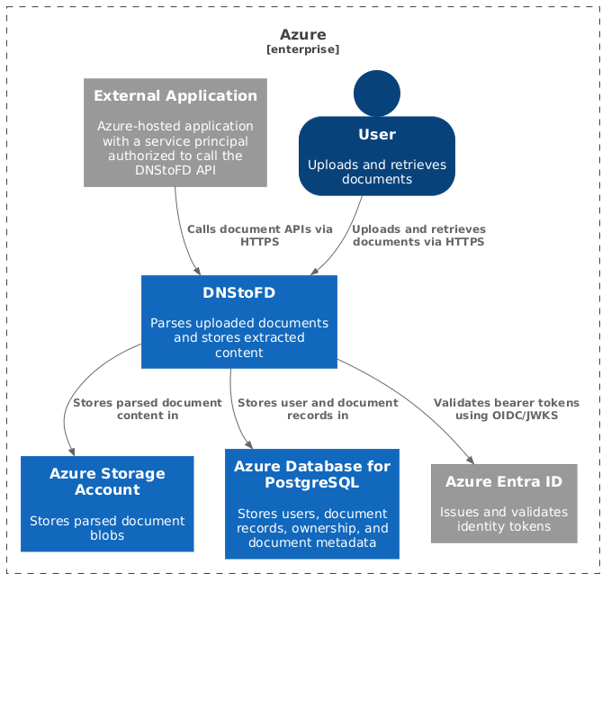

# A Journey from DNS to File Descriptors - Building, Tracing, and Networking in Production

## Vision

We want to create a small application that parses PDFs and stores its content for quick retrieval via pre-signed URLs. The data needs to be isolated and user ownership must be properly maintained.

## Architecture

### System Context

### Container

## Local Development

1. Everything Local
    - Containerized application
    - Azurite to simulate Blob Storage
    - PostgresSQL container for Database

2. Making
