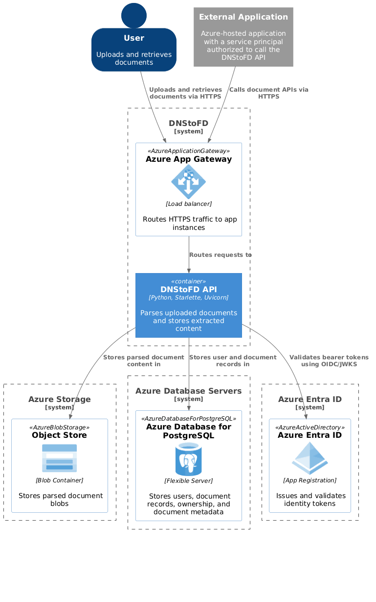
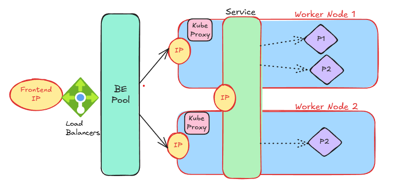
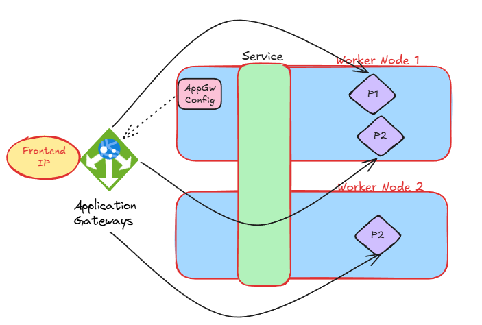

# A Journey from DNS to File Descriptors - Building, Tracing, and Networking in Production

## Vision

We want to create a small application that parses PDFs and stores its content for quick retrieval via pre-signed URLs. The data needs to be isolated and user ownership must be properly maintained.

## Architecture

### System Context

### Container

## Local Development

1. Everything Local

   - Containerized application
   - Azurite to simulate Blob Storage
   - PostgresSQL container for Database
2. Using remote deployments for dependencies

   - Azure Blob Storage
   - Azure Database for PostgreSQL flexible servers

## Networking

1. Virtual Network Boundary for the Kubernetes Cluster
2. How many subnets do we need?
   - Subnet for AKS cluster
   - Subnet for App Gateway (Ingress)

## Remote Deployment

1. All services on Azure with public network access enabled
   - az aks show
   - az aks get-credentials
   - kubectl ...
2. Deploy the application within pods
3. Creating Service Endpoints and restricting public network access
4. Creating Private Endpoints and restricting traffic to the network

## Deep Dives

1. DNS

   - DNS as a global hierarchy:

     .
     └── com
     └── example.com
     ├── www.example.com
     ├── api.example.com
     └── dev.example.com
   - Zone: managed slice of that tree, say, example.com with DNS records:
     example.com        A      93.184.216.34 (IPv4)
     example.com        AAAA   2001:503:83eb::30 (IPv6)
     www.example.com    CNAME  example.com
     api.example.com    A      10.0.1.20
     example.com        MX     mail.example.com
   - Nameserver: a server authoritative for the zone (contains records for it)
   - DNS Primer via `nslookup`: from DNS zone of top-level domain to subdomain zones
   - Resolution of azure storage and azure postgres flexible servers
2. AKS Overview

   - [L4 load balancer]()
     - Backend Pool points to all the worker nodes
     - Kube Proxy is aware of Frontend IP to Service IP mapping
     - Service routes to pods
   - [L7 Ingress](docs/diagrams/aks/aks-with-l7-ingress.png): https://gateway-api.sigs.k8s.io/guides/getting-started/introduction/)
   - [L7 with App Gateway]()
3. App Gateway Overview
4. Extending VNet identity via Service Endpoints (without DNS changes): https://learn.microsoft.com/en-us/azure/virtual-network/virtual-network-service-endpoints-overview
5. Containing traffic within a VNet using Private Endpoints (renewed DNS resolution)
6. Process construct (https://linux-kernel-labs.github.io/refs/heads/master/lectures/processes.html)
7. Lifecycle:

   - DNS packets: strace -e trace=network curl -X GET http://dnstofd.germanywestcentral.cloudapp.azure.com/healthz
   - DNS returns IP: nslookup -query=a http://dnstofd.germanywestcentral.cloudapp.azure.com
   - Routing: ip route get <ip>
   - Network interfaces: ip addr
   - TCP handshake: ss -tan, tcpdump -A -i eth0/lo tcp port <port>
   - TCP to FDs: an HTTP server from scratch and the /proc file system
